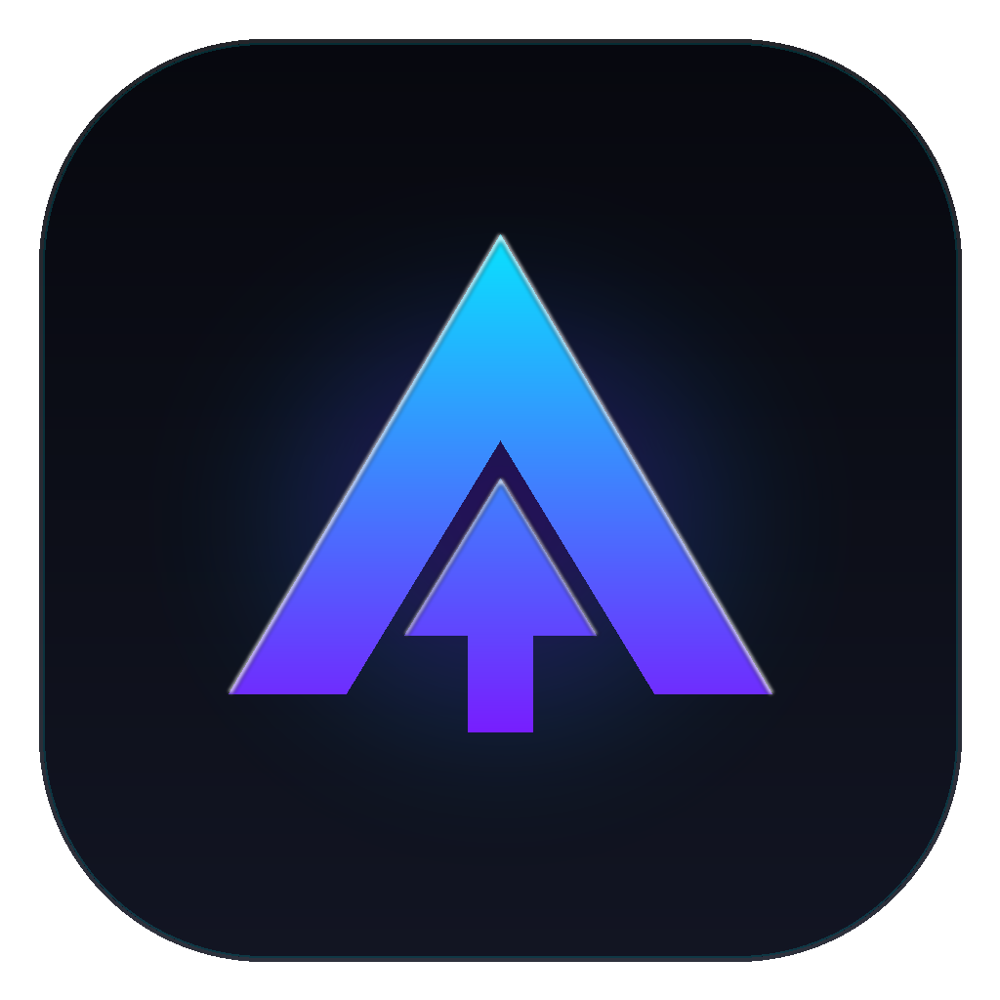
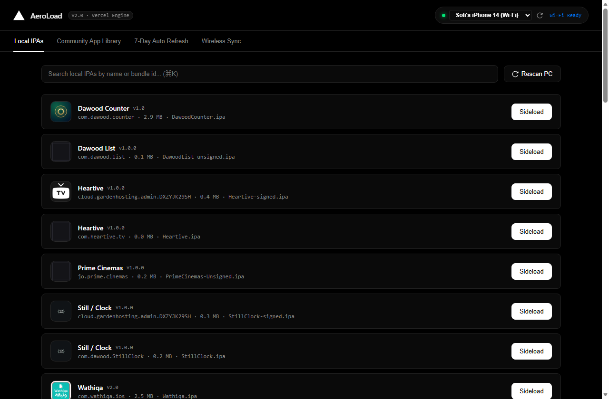
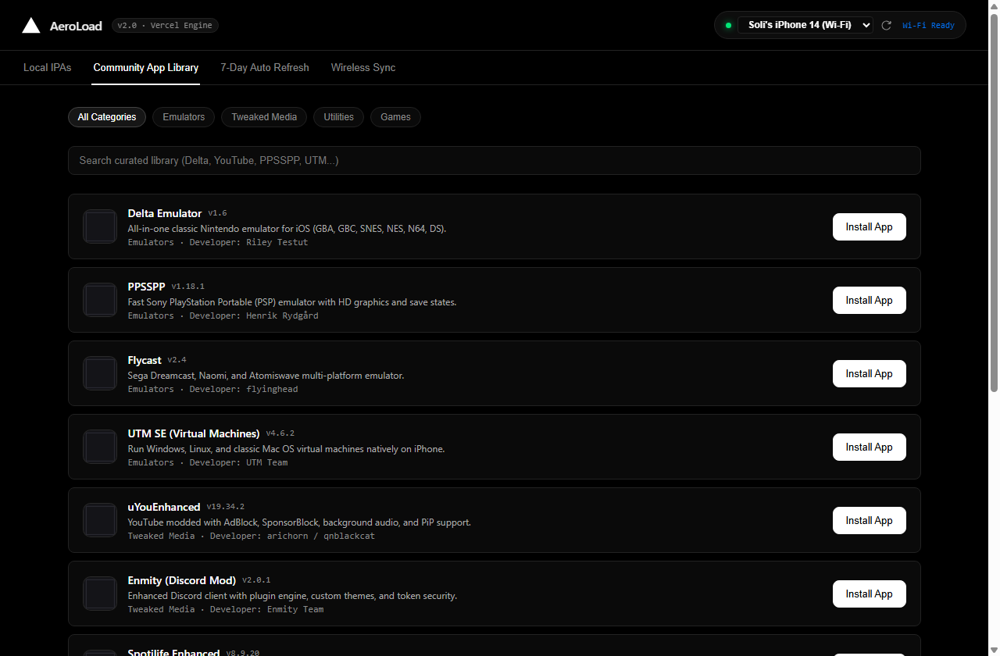
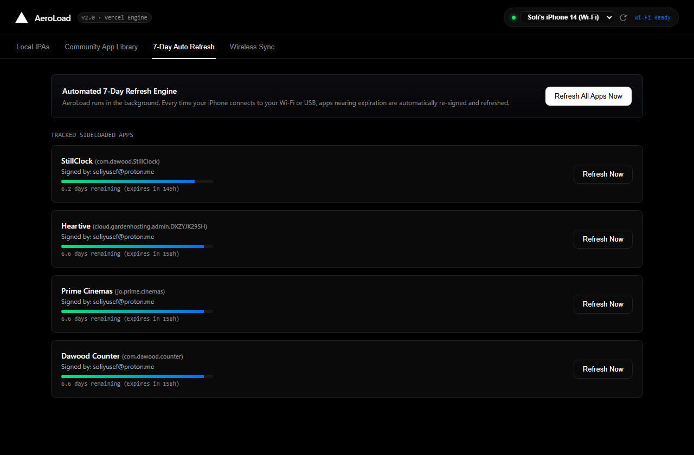
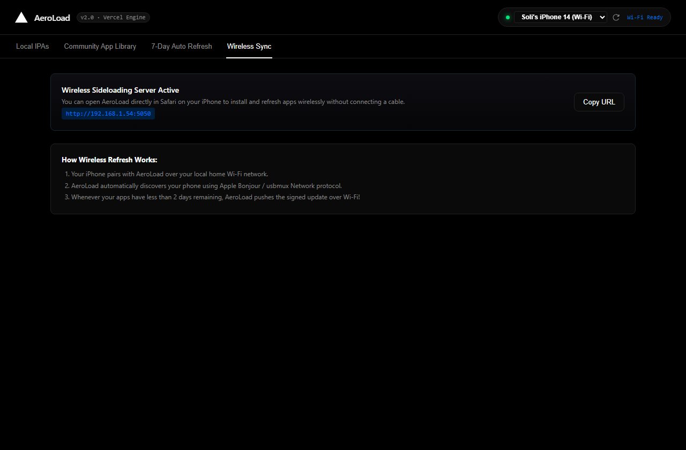
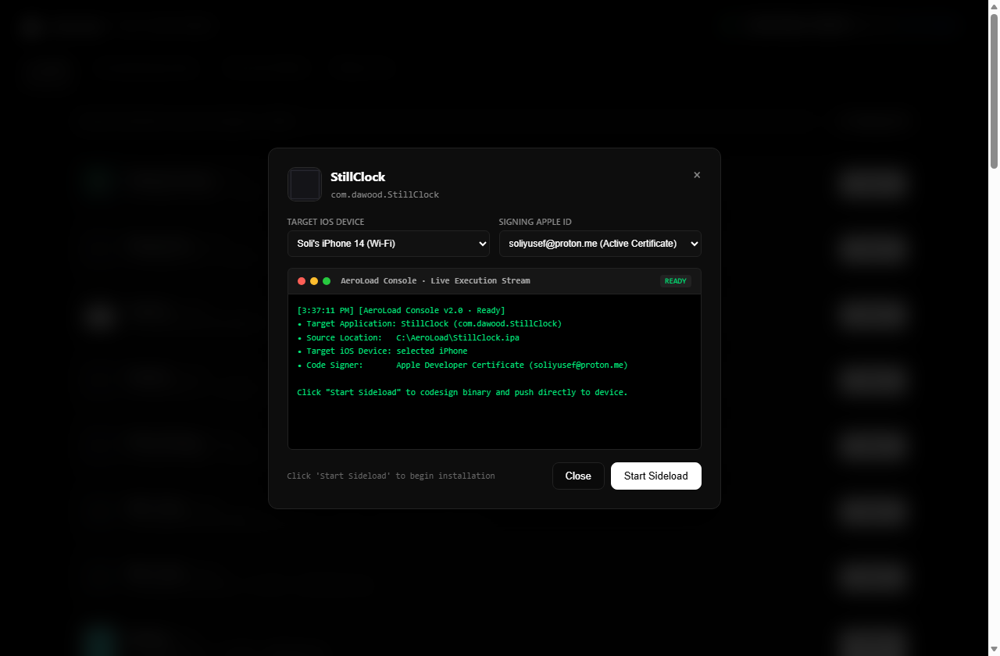

<div align="center">



# AeroLoad

### Modern iOS Sideloading & 7-Day Background Auto-Refresh Suite

[](https://apple.com)
[](https://fastapi.tiangolo.com)
[](https://python.org)
[](https://vercel.com)

</div>

---

## ⚡ Overview

**AeroLoad** is a lightweight, next-generation iOS sideloading suite and wireless 7-day auto-refresh engine with a modern Vercel-inspired dark interface.

Unlike legacy sideloading utilities that require heavyweight dependencies, manual USB replugging, or weekly manual refreshes, AeroLoad operates as a self-contained desktop executable with built-in Wi-Fi device discovery, Mach-O binary codesigning via embedded `zsign`, WidgetKit extension provisioning, and an autonomous background refresh daemon.

---

## ✨ Key Features

- **⚡ 1-Click Wi-Fi & USB Sideloading**: Automatically detects connected iPhones (Wi-Fi or USB) using native `pymobiledevice3` protocol binding.
- **🔄 Autonomous 7-Day Auto-Refresh**: Background daemon continuously tracks expiration timers and wirelessly resigns and reinstalls apps over your local network before developer certificates expire.
- **🧩 iOS 17 WidgetKit & Extension Support**: Automatically inspects Mach-O bundles, injects provisioning profiles into `PlugIns/*.appex`, and configures bundle identifier entitlements.
- **📦 Single Standalone Executable (`AeroLoad.exe`)**: All HTML, CSS, JavaScript, icons, codesigning tools, and Apple developer profiles are bundled directly into the executable.
- **📚 Curated Community App Library**: Browse and 1-click install verified open-source iOS applications (emulators, developer tools, productivity, and media utilities).
- **🖥️ Live Interactive Execution Console**: Real-time terminal modal in the UI displaying live progress, certificate mapping, and installation status.
- **🔒 Zero-Cache Architecture**: Dynamic cache-control middleware and inline reactivity prevent stale application state.

---

## 📸 Screenshots

### 1. Local IPA Scanner & Device Management


### 2. Curated Community App Library


### 3. 7-Day Auto-Refresh Dashboard


### 4. Wireless Sync & Pairing Guide


### 5. Live Sideload Execution Console


---

## 🏗️ Architecture

```
                    ┌────────────────────────────────────────┐
                    │             AeroLoad.exe               │
                    │   (Self-Contained PyInstaller Bundle)   │
                    └──────────────────┬─────────────────────┘
                                       │
            ┌──────────────────────────┴──────────────────────────┐
            ▼                                                     ▼
┌───────────────────────┐                             ┌───────────────────────┐
│     FastAPI Host      │                             │   Edge App Window     │
│  http://localhost:5050│ ◄────────────────────────── │  (Borderless UI Mode) │
└───────────┬───────────┘                             └───────────────────────┘
            │
            ├───────────────┬─────────────────────────┬───────────────────────┐
            ▼               ▼                         ▼                       ▼
 ┌───────────────────┐ ┌──────────────┐    ┌────────────────────┐   ┌─────────────────┐
 │ Sideload Service  │ │ Auto-Refresh │    │  Community Library │   │ Device Scanner  │
 │  (zsign + pymd3)  │ │    Daemon    │    │ (Verified Releases)│   │  (Wi-Fi / USB)  │
 └──────────┬────────┘ └──────┬───────┘    └────────────────────┘   └────────┬────────┘
            │                 │                                              │
            └─────────────────┴──────────────────────┬───────────────────────┘
                                                     ▼
                                        ┌────────────────────────┐
                                        │   Connected iPhone     │
                                        │   (iOS 16 / 17 / 18)   │
                                        └────────────────────────┘
```

---

## 🚀 Quick Start

### Option A: Run Standalone Executable (Recommended)

1. Download **`AeroLoad.exe`** from [Releases](https://github.com/nova-backend-hub/AeroLoad/releases).
2. Double-click **`AeroLoad.exe`** on Windows 10/11.
3. AeroLoad launches in dedicated application mode and detects your connected iPhone over USB or local Wi-Fi.

### Option B: Run from Source

#### Prerequisites
- Windows 10/11 (or macOS / Linux with Apple Mobile Device support)
- Python 3.11+
- Apple Developer Account or free Apple ID

#### Installation

```bash
# 1. Clone the repository
git clone https://github.com/nova-backend-hub/AeroLoad.git
cd AeroLoad

# 2. Install dependencies
pip install fastapi uvicorn requests pymobiledevice3 pillow pydantic psutil

# 3. Launch AeroLoad
python main.py
```

---

## 🛠️ Compiling to `.exe`

To compile AeroLoad into a single self-contained executable with embedded assets and custom icon:

```bash
pip install pyinstaller
py -m PyInstaller --clean AeroLoad.spec
```

The resulting binary will be created in `dist/AeroLoad.exe`.

---

## 📡 Wireless Sync & Wi-Fi Sideloading

To enable wireless sideloading and 7-day auto-refresh over your home network:

1. Connect your iPhone to your PC via USB once and click **"Trust This Computer"**.
2. In iTunes / Apple Devices, check **"Show this iPhone when on Wi-Fi"**.
3. Ensure both your PC and iPhone are connected to the same Wi-Fi network.
4. AeroLoad will automatically detect your device as `iPhone (Wi-Fi)` and perform wireless installations and refresh cycles seamlessly.

---

## 🛡️ Privacy & Security

- All codesigning is performed **locally on your machine** using embedded `zsign`.
- Certificates and keys remain stored exclusively in `%APPDATA%\Sideloadly` or your local profile directory.
- No Apple ID credentials or private keys are ever transmitted to any third-party cloud servers.

---

## 📄 License

This project is licensed under the [MIT License](LICENSE).
